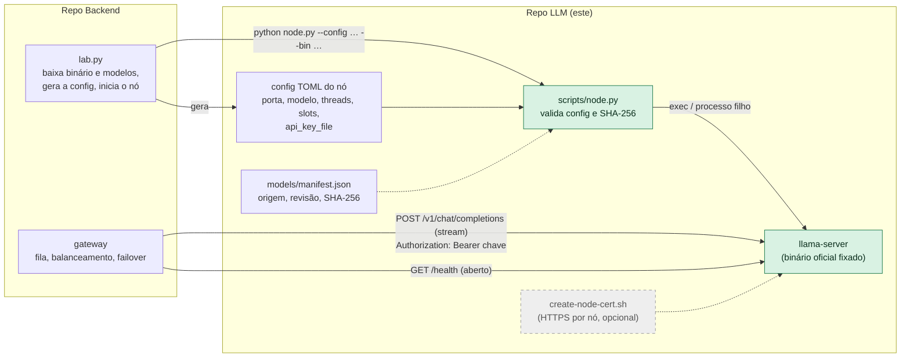
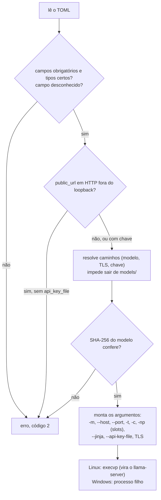
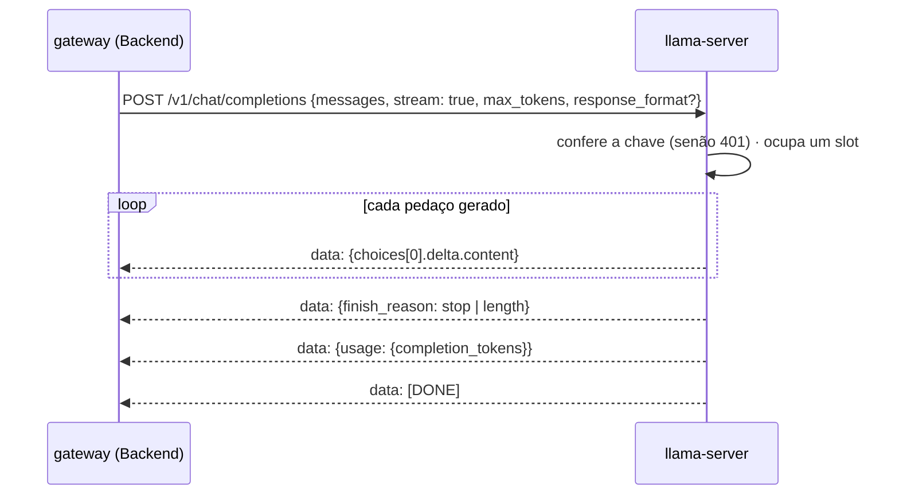

# Explicação do código — Nós LLM

Este repositório prepara e executa processos `llama-server` independentes, um por nó. Ele não tem gateway, fila de
aplicação nem autenticação de usuário: isso é do Backend. A **Parte A** mostra em diagramas onde o nó se encaixa; a
partir da seção 2, o código é explicado arquivo por arquivo.

## 1. Diagramas

**Legenda:** verde = processo deste repositório; cinza tracejado = opcional, fora do caminho padrão.

### 1.1 Onde o nó fica no sistema

### 1.2 O que o `node.py` faz antes de iniciar

### 1.3 Uma geração vista pelo nó

O gateway valida essa sequência com rigor: um `[DONE]` só, sem dados depois, `finish_reason` válido. Os `slots` do nó
precisam ser iguais ao `max_inflight` (K) do nó no gateway; senão o gateway acha que há vaga e o nó enfileira por conta
própria, escondendo a fila do experimento.

### 1.4 Perguntas de entrevista

| Pergunta | Resposta curta |
|---|---|
| Por que um processo por nó? | Cada réplica tem porta, modelo e vagas próprios, e pode estar em outra máquina. O gateway trata cada uma como um destino |
| O que são `slots`? | Quantas gerações o `llama-server` faz ao mesmo tempo. É o K do modelo de fila do experimento |
| Por que conferir o SHA-256 toda vez? | Garante que todas as máquinas rodam exatamente o mesmo modelo; um download corrompido não sobe |
| Por que o `/health` fica aberto e o resto exige chave? | O gateway precisa saber se o nó está vivo sem gastar a chave; o `/health` não expõe nada |
| Por que a chave e não HTTPS no laboratório? | O TLS entre usuário e gateway já protege o usuário. Na LAN, a chave basta para que outro aluno não use o nó, sem montar certificado por máquina |

## 2. `scripts/node.py` — validar configuração e iniciar runtime

- Imports: `argparse` para CLI; `hashlib` para SHA; `ipaddress` para reconhecer loopback; `json` para kwargs do template; `shutil` para descobrir binário; `os.execvp` para substituir o processo; `re` para identificadores/hash; `tomllib` para TOML; `Path` para resolver arquivos.
- `sha256(path)`: lê o GGUF em blocos de 1 MiB, atualiza digest SHA-256 e devolve hex; evita carregar um arquivo de vários GB todo na RAM.
- `load(path, models_root=None)`:
  1. expande `~`, torna caminho de config absoluto e parseia TOML;
  2. exige `node_id`, bind/porta, arquivo/hash do modelo, threads/contexto/slots; recusa campos desconhecidos além da allowlist;
  3. verifica tipos inteiros estritos, evita que `true` seja aceito como inteiro, confere limites de porta/recursos, ID e hash;
  4. confirma que `bind_host` resolve;
  5. se `public_url` existe, exige HTTP(S), host/porta coerentes com bind, sem credenciais/path/query/fragment; HTTP só para loopback;
  6. HTTPS exige par de cert/key; caminhos TLS relativos são relativos à raiz do repositório LLM e arquivos precisam existir;
  7. resolve `model_file`: caminho absoluto explícito é aceito; relativo fica dentro de `models_root`; sem override, root padrão é `models/` do repo; impede traversal por `..`/symlink que saia da raiz;
  8. exige arquivo legível e digest igual ao SHA declarado; devolve configuração e caminho do modelo.
- `argv(config, model, binary)`: forma a lista de argumentos sem invocar shell, começando pelo binário escolhido. Com `api_key_file`, acrescenta `--api-key-file`. Informa `llama-server`, arquivo, bind/porta, threads `-t`, contexto `-c`, paralelismo de slots `-np`, jinja, camadas GPU; acrescenta kwargs serializados e cert/key se TLS estiver ativado.
- `find_binary(explicit)`: escolhe o `llama-server` nesta ordem: `--bin`, a variável `LLAMA_SERVER` (usada pelo `lab.py`) e o `PATH` (devenv).
- `main()`: registra `--config`, `--check`, `--models-root` e `--bin`; trata configuração inválida com código 2; em check imprime estado/hash/runtime encontrado sem iniciar; sem `--check` verifica existência do executável e chama `os.execvp`, tornando o llama-server o processo corrente. No Windows, roda como processo filho (`subprocess.call`), porque lá o `execvp` cria outro processo e o pai perderia o controle dele.
- Bloco `__main__`: transforma retorno em exit status.

## 3. Scripts de shell

### `scripts/start-node`

É um launcher curto com `set -euo pipefail`; chama Python do ambiente atual com o caminho de `node.py` relativo ao próprio script e repassa todos os argumentos (`"$@"`). Deve ser executado dentro de `devenv shell` para encontrar `llama-server`.

### `scripts/download-models`

- `set -euo pipefail`: interrompe em erro, variável ausente ou erro de pipeline.
- Cria diretório `models/`.
- Usa `curl --fail --location --continue-at -` para baixar duas revisões fixas Qwen3 1.7B e Qwen3.5 4B, retomando download parcial.
- Executa `verify-models` ao final; falha se hash divergir. É operação opt-in que baixa vários GB, não roda nos testes normais.

### `scripts/verify-models`

- Lê `models/manifest.json` ou manifesto fornecido como argumento e define a raiz de modelos (default `models/`).
- Percorre cada item, informa ausente ou calcula SHA-256 streaming com `hashlib.file_digest`.
- Compara com hash oficial fixado, imprime OK/DIVERGENTE, acumula falhas e retorna exit code 1 se qualquer peso faltar/divergir.

### `scripts/create-node-cert.sh`

- Exige ID, SAN primário e, opcionalmente, SANs extras; valida ID/caracteres, duração (1–825 dias) e formato DNS/IP.
- Seleciona `NODE_SECRETS_DIR` ou `secrets/`, cria diretório com umask restritiva e pega lock exclusivo baseado no ID para impedir provisionamento concorrente.
- Recusa se key/cert já existirem: não faz rotação nem sobrescreve chaves.
- Classifica o SAN primário como IP ou DNS, junta SANs adicionais, gera chave RSA 3072 e certificado self-signed de servidor via OpenSSL em pasta temporária.
- Define extensões TLS (não CA, key usage, serverAuth e subjectAltName), protege chave com 0600 e certificado público com 0644, move arquivos ao local definitivo e remove temporários/lock via trap.
- Mostra instrução explícita: copiar somente certificado público ao trust bundle do Backend; a chave privada permanece no host LLM. Para host remoto/produção, preferir CSR e CA aprovada.

## 4. `configs/*.toml` — perfis

Cada arquivo define um único runtime e os seus limites. Os comentários identificam combinações pretendidas com Backend.

- `qwen3-small.toml`: nó `llm-small-a`, porta 8101, modelo Qwen3 1.7B Q4_K_M, 4 threads, contexto 4096, um slot, GPU desligada, HTTPS e paths próprios de certificado/chave.
- `qwen3-small-replica.toml`: réplica equivalente `llm-small-b` na porta 8103, mesmo GGUF/hash, 2 threads e um slot. Equivalência de pesos não significa aumento automático de CPU física.
- `qwen35-large.toml`: `llm-large-a` na porta 8102, Qwen3.5 4B Q4_K_M, 2 threads, contexto 4096, um slot e HTTPS.
- `qwen3-small-dev-http.toml`: mesma identidade/porta/modelo do nó pequeno, mas HTTP somente loopback para perfil mínimo de desenvolvimento; não usa key/cert.
- `qwen3-small-replica-dev-http.toml`: perfil HTTP local da réplica pequena na porta 8103; destinado ao perfil de réplicas em loopback.
- `qwen35-large-dev-http.toml`: perfil HTTP local do modelo maior na porta 8102.
- `model_sha256`: fixa integridade; fonte de hash canônica é `models/manifest.json`.
- `chat_template_kwargs`: parâmetros entregues ao runtime para comportamento do template, não para fila ou autorização.
- `bind_host`/`bind_port`: interface e socket de escuta do processo.
- `public_url`: URL que o Backend usará; o checker exige scheme e porta válidos. HTTP fora do loopback só com `api_key_file`.
- `api_key_file`: arquivo com a chave do nó (o `lab.py` gera em `.lab/node-api-key`); vira `--api-key-file`.
- `context_tokens`, `threads`, `slots`, `n_gpu_layers`: recursos de runtime. Contexto e slots têm efeito em memória/concorrência e devem ser medidos no host; perfis são valores iniciais, não benchmark.

## 5. Ambiente `devenv.nix`

- A lista `packages` instala no ambiente declarativo llama.cpp, curl, jq, Python 3.13 e OpenSSL; não altera instalação global.
- `PYTHONUNBUFFERED` torna logs Python imediatos.
- `enterShell` mostra versão/binário do runtime e Python, ajudando a registrar ambiente. A versão impressa de `llama-server` depende de suporte do binário empacotado.

## 6. Testes `tests/test_node.py`

- Imports: carrega `node.py` diretamente para testar helpers sem iniciar serviço.
- `test_node_certificate_script_creates_san_cert_and_never_overwrites`: usa diretório temporário, gera cert para loopback, verifica SAN e modo da chave, repete a operação e garante recusa de overwrite.
- `test_runtime_argv_uses_slot_limit_and_separates_bind`: confere host/porta, `-np`, flags TLS e JSON dos kwargs.
- `test_load_resolves_tls_paths_from_repository_and_checks_config_types`: usa fixtures pequenas para paths TLS e exige tipos de inteiro estritos.
- `test_load_checks_manifest_hash_without_external_dependencies`: arquivo pequeno de fixture testa verificação SHA sem baixar modelo.
- `test_load_accepts_explicit_models_root_with_temporary_fixture`: prova resolução com subdiretório em root explícita.
- `test_load_rejects_relative_model_path_traversal`: garante que caminho relativo não escape a raiz.
- `test_load_accepts_absolute_model_path`: documenta suporte consciente a path absoluto selecionado pelo operador.
- `test_api_key_file_is_passed_to_runtime_and_allows_lan_http`: nó na LAN com chave; confere `--api-key-file`, `-np` e o binário escolhido.
- `test_lan_http_without_api_key_is_rejected`: HTTP na LAN sem chave é recusado.
- `test_find_binary_prefers_explicit_path_then_environment`: ordem de busca do binário.

Esses testes verificam configuração, integridade e argv com arquivos pequenos; não carregam GGUF nem demonstram geração, health real ou cancelamento de runtime.

## 7. Manifesto e pesos

`models/manifest.json` registra nomes, revisões de origem, arquivos e hashes. Os arquivos GGUF são artefatos pesados locais e não fazem parte da explicação nem devem ser editados como código. Hash correto prova integridade do arquivo, não licença, qualidade, procedência completa ou viabilidade do modelo na memória disponível.
